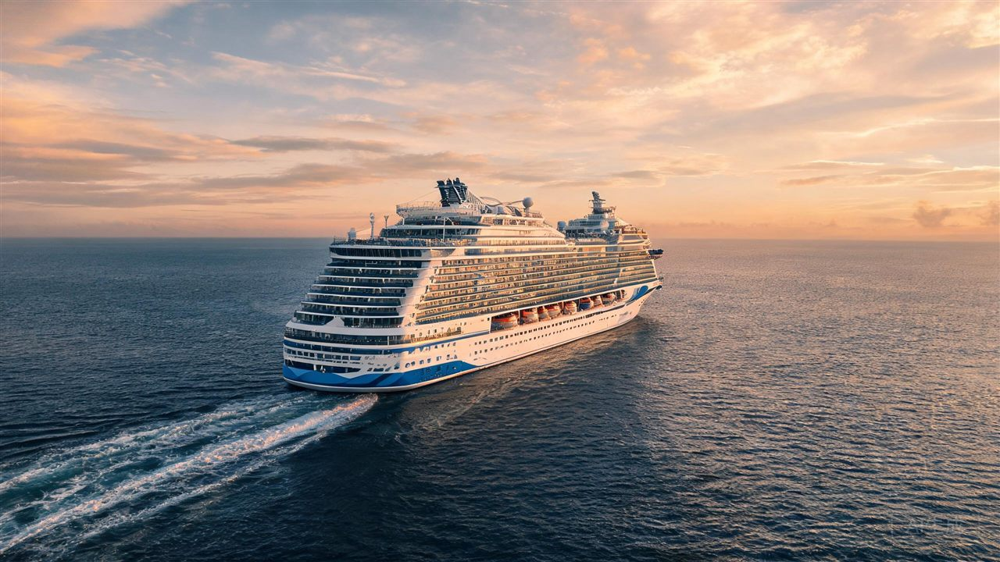

# Swiper 课堂任务 · 第 6 点「课堂任务 + 思政升华」完成记录

> 记录时间：2026-11-05 14:45:10 · 模型：DeepSeek-V4.1-Flash · 作答文件：`swiper-task.html`
> 第 4 点学生任务原 4 个任务（拖动、圆点箭头、自动播放、六种效果）均已完成并通过验证，本记录聚焦第 6 点的三关进阶。

---

## 任务一 · 提示词工程师（Swiper 配置生成）

**目标**：让 AI 输出 `#wySw4` 的配置——循环、自动播放 3.2 秒、拖动后不停、圆点可点、初始 `cube`。

### 第 1 轮提示词（故意写得比较简单）

> 帮我写 `#wySw4` 的 Swiper 初始化配置：要循环播放、自动播放、底部圆点，效果用 cube。

### 第 1 轮 AI 回答

```js
var swiper = new Swiper('#wySw4', {
  loop: true,
  effect: 'cube',
  autoplay: true,
  pagination: { clickable: true }
});
```

**验证结果：不通过。** 圆点没有渲染（`pagination` 缺少 `el`）；自动播放用默认 3000ms 且 `disableOnInteraction` 默认 `true`，手动拖动后自动播放会停止，不符合"3.2 秒 + 拖动后继续"。

### 第 2 轮提示词（补齐约束）

> 请只使用 Swiper 11，初始化 `#wySw4`：`loop: true`；`autoplay` 的 `delay: 3200`、`disableOnInteraction: false`；分页器指定 `el: '#wyPag4'` 且 `clickable: true`；`effect: 'cube'`。请给出可直接粘贴的完整配置。

### 第 2 轮 AI 回答（最终采用）

```js
var lyc_0817_swiper4 = new Swiper('#wySw4', {
  loop: true,
  speed: 800,
  effect: 'cube',
  grabCursor: true,
  autoplay: { delay: 3200, disableOnInteraction: false },
  pagination: { el: '#wyPag4', clickable: true }
});
```

**验证结果：通过。** 实测参数：`loop: true`、`delay: 3200`、`disableOnInteraction: false`、`pagination.el: '#wyPag4'`、`clickable: true`、`effect: 'cube'`、分页圆点 6 个、自动播放运行中；`cube` 转动画面见截图。

**一句话结论**：两轮提示词补齐了容器选择器、动画时长与交互后继续播放这三条约束后，配置与需求完全一致。

验证截图：`.screenshots/swiper-task/task1-verify-cube.png`

---

## 任务二 · 仿写官方 `creative` 特效

**参考文件**：`swiper/demo/257-effect-creative.html`（Swiper 11 官方 creative 示例）。

### 官方示例要点

```js
effect: 'creative',
creativeEffect: {
  prev: { shadow: true, translate: [0, 0, -400] },
  next: { translate: ['100%', 0, 0] }
}
```

### 本次实现（第 7 个按钮「creative 电影墙」）

按钮：`<button data-fx="creative">creative 电影墙（课堂未讲·拓展）</button>`
配置：在 `lyc_0817_config4(effect)` 中按 effect 追加 `creativeEffect`，并通过原有的"销毁 → 重建"逻辑生效。

```js
if (lyc_0817_effect === 'creative') {
  lyc_0817_cfg.creativeEffect = {
    prev: {
      shadow: true,
      origin: 'center left',
      translate: ['-35%', 0, -250],   // 左移、后退到 z 轴 -250
      rotate: [0, 12, -10],           // 带一点侧向角度
      scale: 0.75,                    // 缩小
      opacity: 0.65
    },
    next: {
      translate: ['100%', 0, 0],      // 从右侧画框外进入
      scale: 1.15                     // 放大入场
    }
  };
}
```

**验证结果：通过。** 效果按钮共 7 个，`effect` 为 `creative`，`prev/next` 参数生效，分页圆点保持 6 个；动画中间帧可见"上一张缩小左移带角度、下一张从右侧放大进入"，截图见 `task2-creative.png`。

### prev / next 的 transform 各控制什么？

- **`prev`**：控制**正在离场的上一张**在切换过程中的终态——`translate` 决定位移（`['-35%', 0, -250]` 表示向左 35%、后退 250px）、`rotate` 决定旋转角度、`scale` 决定缩小比例、`opacity` 决定淡出程度，`origin` 决定以哪个点为变换中心。
- **`next`**：控制**即将入场的下一张**在进场前的位置与形态——`translate: ['100%', 0, 0]` 表示先停在画框右侧一整屏外，`scale: 1.15` 表示从放大状态收回到原始大小；随着切换进度推进，两者的 transform 会插值回到默认状态（`translate 0`、`scale 1`、`opacity 1`）。

验证截图：`.screenshots/swiper-task/task2-creative.png`

---

## 任务三 · 综合创作 + 技术答辩

### ① 第六件展品「爱达·魔都号」

- 图片：AI 生成（横版 16:9，最终 1280×720，约 184KB），保存为 `swiper-imgs/aida_modu.jpg`。
- 生图提示词要点：`photorealistic aerial photograph of "Adora Magic City" (爱达·魔都号), China's first domestically built large cruise ship, sailing on deep blue ocean at golden hour, 16:9 landscape, cinematic travel photography, no text`。
- 四个演示台均补上第六张 slide（每台 6 张，圆点同步变为 6 个），slide 结构与原有展品一致：

```html
<div class="swiper-slide">
  
  <div class="wy-cap"><h3>爱达·魔都号</h3><p>第六件展品 · AI 生成图片</p></div>
</div>
```

**验证结果：通过。** 四个轮播 slide 数量均为 6；第六张图片加载成功（`naturalWidth 1280 / naturalHeight 720`，16:9）；截图见 `task3-aida-slide.png`。

### ② 新增一项课堂没讲的能力：键盘方向键切换（Keyboard 模块）

选择理由：Swiper 的 `zoom` 需要手势与容器配置、`mousewheel` 会抢占整页滚动，而 `keyboard` 改动小、对课堂展示友好，也便于现场答辩演示。

```js
keyboard: {
  enabled: true,
  onlyInViewport: true   // 只在轮播进入可视区时响应，避免影响整页滚动
}
```

**验证结果：通过。** 先暂停自动播放排除干扰，按 `→` 后 `realIndex` 从 0 → 1；`onlyInViewport` 保证页面滚动时不误触。该能力仅挂在 `#wySw4`，不影响其它三个演示台。

### ③ 与 AI 的关键对话记录（摘要）

1. **提示词**："给 `#wySw4` 增加第 7 个按钮，点击后切换到 Swiper 的 creative 效果，上一张缩小左移、下一张放大进入。"
   **AI 回答**：给出 `creativeEffect.prev/next` 配置，并提醒必须沿用"销毁旧实例再重建"的切换流程，不能只改参数。
2. **提示词**："生成一张爱达·魔都号邮轮的横版 16:9 图片，写实摄影风格，用于轮播第六张展品。"
   **AI 回答**：生成 `aida_modu.jpg`（2560×1440），并建议压缩到 1280×720 以减小体积。
3. **提示词**："在效果实验台上加一个课堂上没讲过的 Swiper 能力，要求不干扰页面滚动。"
   **AI 回答**：推荐 `keyboard` + `onlyInViewport: true`，给出配置并说明与自动播放的共存方式。

### ④ 答辩准备（四问速答）

1. **为什么 `creative` 不用改 HTML？** 它仍然基于标准三层结构，只是把切换动画交给 `creativeEffect` 计算 transform。
2. **为什么换效果要 `destroy` 再 `new`？** Swiper 在初始化时就把 effect 对应的模块、样式和参数固定到实例上，运行期改 `params.effect` 不会重新装配效果模块，只能销毁重建。
3. **键盘会不会影响其它轮播？** 不会，配置只写在 `#wySw4` 的实例上，`onlyInViewport` 还限定只有它出现在视口时才响应。
4. **新增第六张图会让页面变慢吗？** 图片已压缩为 1280×720、约 184KB，且与原有图片同目录本地加载，不依赖外部 CDN。

---

## 交付物清单

| 文件 | 说明 |
|---|---|
| `swiper-task.html` | 已完成全部任务与三关进阶的可运行页面 |
| `swiper-imgs/aida_modu.jpg` | AI 生成的第六件展品图片（1280×720） |
| `.screenshots/swiper-task/task1-verify-cube.png` | 任务一 cube 验证截图 |
| `.screenshots/swiper-task/task2-creative.png` | 任务二 creative 动画中间帧 |
| `.screenshots/swiper-task/task3-aida-slide.png` | 任务三 第六件展品截图 |

> 注：第 4 点任务 4 要求"初始效果为 slide"，因此页面打开时 `#wySw4` 仍为 `slide`，`cube` 与 `creative` 通过按钮切换验证。
